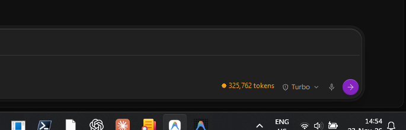

# Google AI Studio-Style Multimodal Token Meter & Cognitive HUD

Zero-cognitive-load multimodal token counter (`text + image + audio + video + PDF`) anchored directly inside Antigravity's bottom input bar, just to the left of the permanent `shield + Turbo` cluster across all conversation width modes (`Narrow | Default | Wide | Fill`).

## 3 Cognitive Token Tiers (Zero Peripheral Noise)

During complex multi-agent setups or hackathon sprints, operators should not burn mental bandwidth calculating when a thread will drift or trigger context compaction. Theme accent colors are intentionally suppressed on the HUD pill in favor of 3 deterministic cognitive tiers applied to both the indicator dot (`•`) and the token count:

| Token Range | HUD Color | Hex | Cognitive Signal |
| :--- | :--- | :--- | :--- |
| **`< 300,000 tokens`** | Calm Secondary Grey | `#8E8E8E` | **Zero distraction** — blends naturally with native toolbar controls while typing or idle. |
| **`300,000 – 449,999 tokens`** | Warning Amber / Yellow | `#F59E0B` | **"1 mission left"** — finish the current mission and prepare a clean handoff. |
| **`>= 450,000 tokens`** | Critical Red | `#EF4444` | **"Rotate thread now"** — switch to a fresh thread immediately before compaction or attention decay. |

### Yellow Warning Tier (`325,762 tokens` — `#F59E0B`, 1 mission remaining)

### Red Critical Tier (`554,677 tokens` — `#EF4444`, switch thread immediately)

## Key Stability Guarantees
- **Exact Gemini API Telemetry Anchor (`count_conversation_tokens`)**: Anchors the displayed total directly to the last server-measured Gemini API turn (`input_tokens + cache_read_tokens + output_tokens`) and adds only the live post-anchor delta (subsequent steps, newly uploaded files, staged files, and live typing/paste draft), matching API telemetry to the exact token.
- **Read-Only True User Focus Lock (`resolve_active_conversation_id`)**: When the sidecar panel is closed (the 99% steady state) and multiple background agents write to other sessions concurrently, locks focus strictly in **read-only mode** (`0` writes to IDE internals) on the conversation with the most recent `last_user_view_time` in `annotations/*.pbtxt` (ignoring `archived: true` entries and orphan IDs without a session directory), falling back to transcript `mtime` only when `annotations/` is absent.
- **Sub-0.5 ms UI Tick Engine (`MultimodalTokenMeter` & `_tick_tokens`)**: Incremental `os.scandir()` annotation scanner indexed by `(mtime_ns, size)` with a `1.5 s` focus TTL + `TokenBreakdown` cache keyed by `(conversation_id, transcript_mtime_ns, transcript_size, uploads_dir_mtime_ns)` + redundant `_redraw_pill()` skip when visual state is unchanged — reducing live Tk thread tick latency from `177–672 ms` down to **`0.40–0.48 ms`** across 600+ session folders.
- **Voice Mode Blue/Violet Halo Tolerance (`_is_dark_input_bar_surface`)**: Keeps the HUD visible when Antigravity's Voice Mode casts a blue/violet glow across the bottom bar while still hiding cleanly when bright modals cover the bar or when Antigravity is not the foreground window.
- **Permanent `Shield + Turbo` Cluster Anchor + `2 px` Hysteresis & Shrink-Deadlock Recovery**: Locks onto the permanent `shield + Turbo` cluster whether or not the round `Send` button is rendered (empty input box or Voice Mode), with pixel-run bounds (`min_offset = 89 px`) that mathematically exclude `Send` (`32 px`), mic (`56 px`), and chevron (`81 px`), plus `2 px` deadzone hysteresis and stale-anchor clearing when the bar narrows.
- **Server-Restart Watchdog (`main.mjs`)**: Lightweight exponential-backoff watchdog (`750 ms` -> `12 s`) that respawns the singleton HUD (`Local\AGY_Studio_Token_Pill_Singleton`) automatically after any sidecar or server restart (`17/17 pytest` passing).
