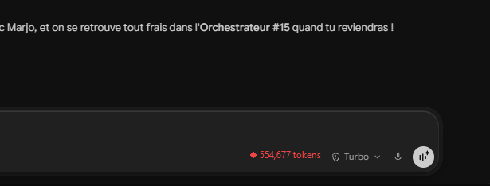

# Google AI Studio-Style Multimodal Token Meter & Cognitive HUD

Zero-cognitive-load multimodal token counter (`text + image + audio + video + PDF`) anchored directly inside Antigravity's bottom input bar, just to the left of the permanent `shield + Turbo` cluster across all conversation width modes (`Narrow | Default | Wide | Fill`).

## 3 Cognitive Token Tiers (Zero Peripheral Noise)

During complex multi-agent setups or hackathon sprints, operators should not burn mental bandwidth calculating when a thread will drift or trigger context compaction. Theme accent colors are intentionally suppressed on the HUD pill in favor of 3 deterministic cognitive tiers applied to both the indicator dot (`•`) and the token count:

| Token Range | HUD Color | Hex | Cognitive Signal |
| :--- | :--- | :--- | :--- |
| **`< 300,000 tokens`** | Calm Secondary Grey | `#8E8E8E` | **Zero distraction** — blends naturally with native toolbar controls while typing or idle. |
| **`300,000 – 449,999 tokens`** | Warning Amber / Yellow | `#F59E0B` | **"1 mission left"** — finish the current mission and prepare a clean handoff. |
| **`>= 450,000 tokens`** | Critical Red | `#EF4444` | **"Rotate thread now"** — switch to a fresh thread immediately before compaction or attention decay. |

### Yellow Warning Tier (`325,762 tokens` — `#F59E0B`, 1 mission remaining)

### Red Critical Tier (`554,677 tokens` — `#EF4444`, switch thread immediately)

## Key Stability Guarantees
- **Voice Mode Blue/Violet Halo Tolerance (`_is_dark_input_bar_surface`)**: Keeps the HUD visible when Antigravity's Voice Mode casts a blue/violet glow across the bottom bar while still hiding cleanly when bright modals cover the bar or when Antigravity is not the foreground window.
- **Permanent `Shield + Turbo` Cluster Anchor + `2 px` Hysteresis**: Locks onto the permanent `shield + Turbo` cluster whether or not the round `Send` button is rendered (empty input box or Voice Mode), with a `2 px` deadzone that eliminates horizontal jitter.
- **Server-Restart Watchdog (`main.mjs`)**: Lightweight exponential-backoff watchdog (`750 ms` -> `12 s`) that respawns the singleton HUD (`Local\AGY_Studio_Token_Pill_Singleton`) automatically after any sidecar or server restart.
